# Tugas Praktikum Framework Laravel

Tugas praktikum Pemrograman Web menggunakan framework Laravel.

- **Nama:** AMARA DWI NATARIN
- **NPM:** 2513020050
- **Kelas:** 2A Sistem Informasi
- **Repository:** https://github.com/amaranatarin-arch/laravel-2a

## Daftar Isi

1. [Mengenal Route dan Controller](#1-mengenal-route-dan-controller)
2. [Parsing Data ke View](#2-parsing-data-ke-view)
3. [Sistem Templating](#3-sistem-templating)
4. [Membuat CRUD Tampil Data](#4-membuat-crud-tampil-data)
5. [Membuat CRUD Simpan Data](#5-membuat-crud-simpan-data)
6. [Membuat CRUD Ubah Data](#6-membuat-crud-ubah-data)
7. [Membuat CRUD Hapus Data](#7-membuat-crud-hapus-data)
8. [Tentang Migration, Seeder dan Factory](#8-tentang-migration-seeder-dan-factory)
9. [Membuat Autentifikasi](#9-membuat-autentifikasi)

## Teknologi

- PHP 8.3 atau lebih baru
- Laravel 13
- MySQL (XAMPP)
- Composer
- Bootstrap 5 (CDN), hanya untuk halaman mahasiswa dan segitiga

## Cara Menjalankan

1. Nyalakan **Apache** dan **MySQL** di XAMPP, lalu buka phpMyAdmin
   (`http://localhost/phpmyadmin`) dan buat database kosong bernama `company`.

2. Clone repository dan masuk ke foldernya:

   ```
   git clone https://github.com/amaranatarin-arch/laravel-2a.git
   cd laravel-2a
   ```

3. Install dependency:

   ```
   composer install
   ```

4. Siapkan file environment:

   ```
   copy .env.example .env
   php artisan key:generate
   ```

   Lalu ubah pengaturan database dan session di file `.env`:

   ```
   DB_CONNECTION=mysql
   DB_HOST=127.0.0.1
   DB_PORT=3306
   DB_DATABASE=company
   DB_USERNAME=root
   DB_PASSWORD=

   SESSION_DRIVER=file
   ```

5. Buat tabel dan isi data contoh:

   ```
   php artisan migrate:fresh
   php artisan db:seed
   ```

6. Jalankan server:

   ```
   php artisan serve
   ```

7. Buka `http://localhost:8000` di browser.

**Akun untuk login** (dari `UserSeeder`):

| Email | Password |
|-------|----------|
| `amara@mail.com` | `123456` |

> Koneksi internet diperlukan karena Bootstrap dan gambar banner dimuat dari internet.

---

## 1. Mengenal Route dan Controller

Route didaftarkan di `routes/web.php` dan diarahkan ke controller.

| URL | Tujuan | Keterangan |
|-----|--------|------------|
| `/about` | Fungsi di route | Menampilkan tulisan laman About |
| `/web` | `Web@home` | Menampilkan tulisan dari controller Web |
| `/profil/{nama}` | `Web@profil` | Contoh mengirim data lewat URL |

File: `app/Http/Controllers/Web.php` (dibuat manual) dan
`app/Http/Controllers/Dashboard.php` (dibuat dengan `php artisan make:controller Dashboard`).

---

## 2. Parsing Data ke View

Data dikirim dari Controller ke View memakai array `$data`, lalu ditampilkan
dengan Blade (`{{ }}` dan `@foreach`). Form memakai `@csrf` dan method POST.

| URL | Controller | Fungsi | Keterangan |
|-----|------------|--------|------------|
| `/biodata` | `Web` | `biodata` | Mengirim data nama dan alamat ke view |
| `/kalkulator` | `KalkulatorController` | `home` | Kalkulator perkalian (materi) |
| `/kalkulator/proses` (POST) | `KalkulatorController` | `proses` | Proses perkalian (materi) |
| `/daftar/mahasiswa` | `MahasiswaController` | `index` | Tabel daftar mahasiswa (latihan) |
| `/kalkulator/segitiga` | `KalkulatorController` | `segitiga` | Form luas segitiga (latihan) |
| `/kalkulator/segitiga/proses` (POST) | `KalkulatorController` | `hitungSegitiga` | Proses luas segitiga (latihan) |

**Contoh pengujian**

- `/kalkulator`: isi `4` dan `5`, klik **HITUNG**, hasilnya **20**.
- `/daftar/mahasiswa`: menampilkan 4 baris (Anton, Budi, Ani, Sinta).
- `/kalkulator/segitiga`: isi alas `10` dan tinggi `6`, klik **HITUNG**, hasilnya **30**.

**Hasil**

Kalkulator perkalian, sebelum dihitung:
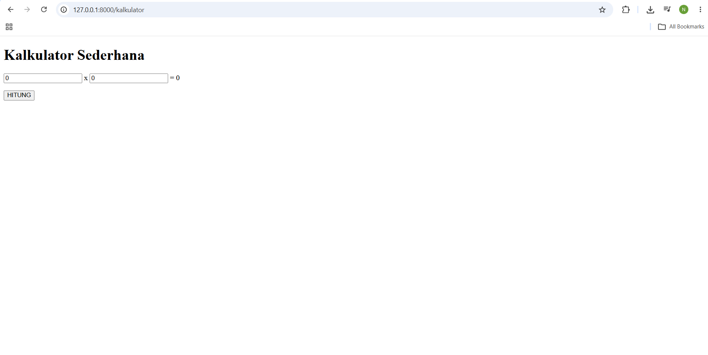

Kalkulator perkalian, setelah dihitung:
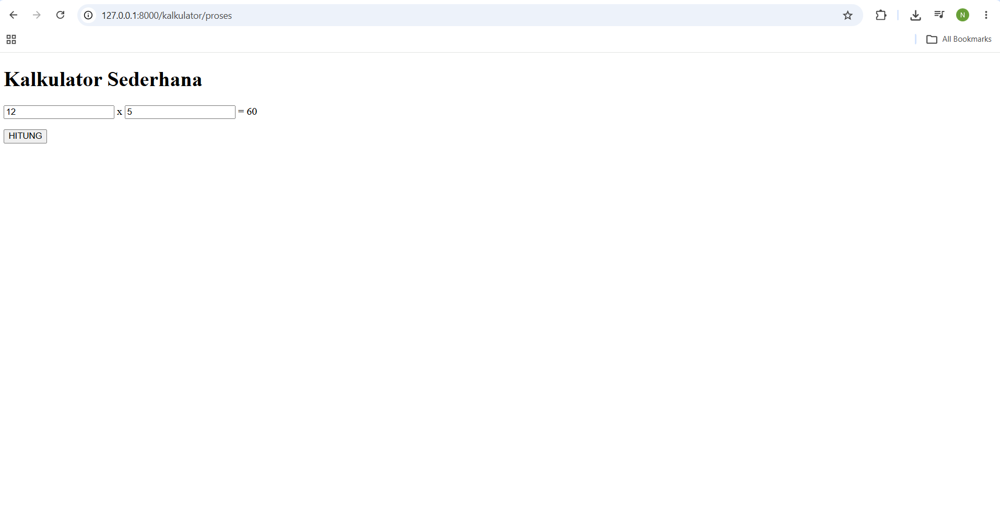

Daftar mahasiswa:
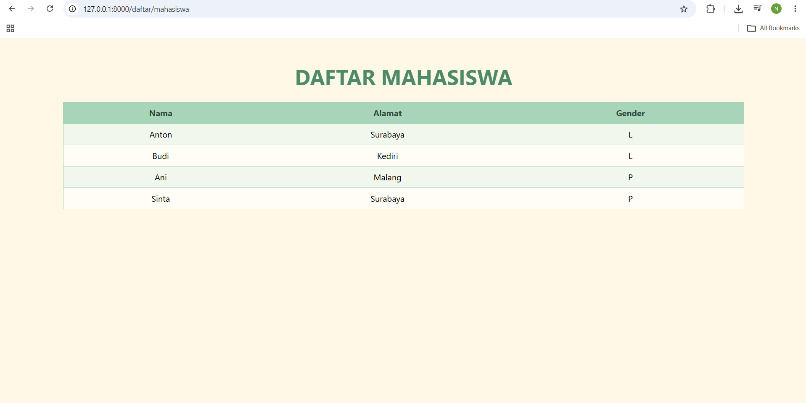

Kalkulator segitiga, sebelum dihitung:
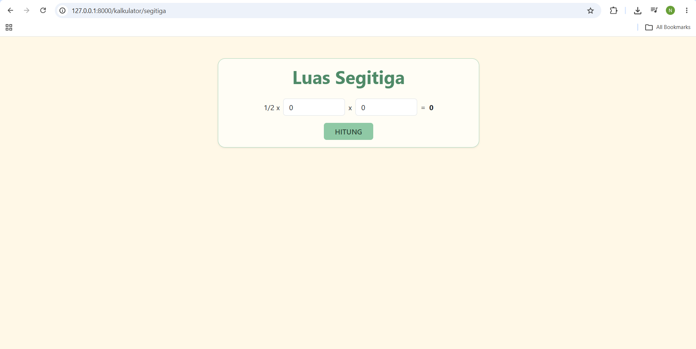

Kalkulator segitiga, setelah dihitung:
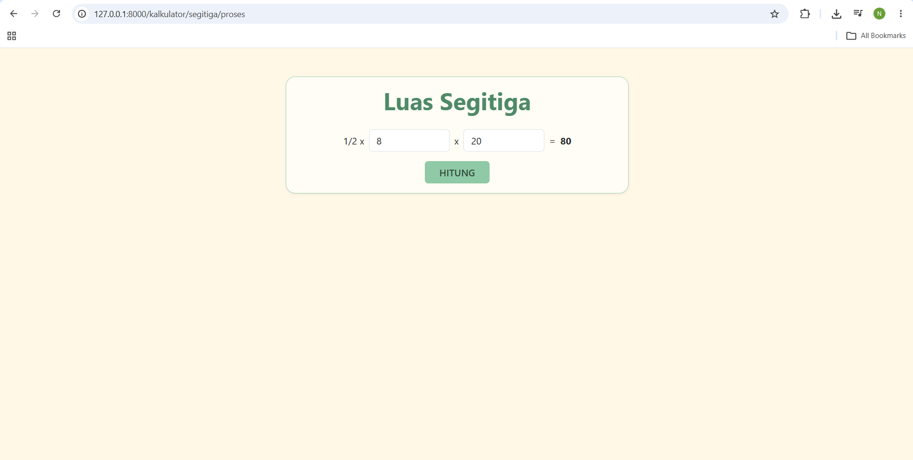

---

## 3. Sistem Templating

Layout halaman dibagi menjadi header, sidebar, dan content memakai Blade
(`@include`, `@extends`, `@section`, `@yield`).

| File | Fungsi |
|------|--------|
| `resources/views/dashboard.blade.php` | Layout utama |
| `resources/views/template/header.blade.php` | Header dan banner |
| `resources/views/template/sidebar.blade.php` | Menu samping |
| `resources/views/home.blade.php` | Konten halaman Home |
| `resources/views/gallery.blade.php` | Konten halaman Gallery |
| `app/Http/Controllers/DashboardController.php` | Fungsi `home` dan `gallery` |
| `public/css/dashboard.css` | CSS layout |

CSS layout memakai nama `dashboard.css` (bukan `style.css` seperti di modul)
supaya tidak menimpa `style.css` milik halaman mahasiswa dan segitiga.

**Hasil**

Halaman Home:
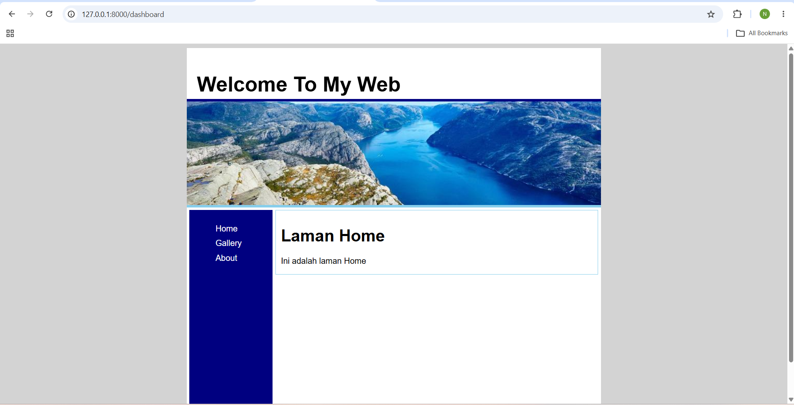

Halaman Gallery:
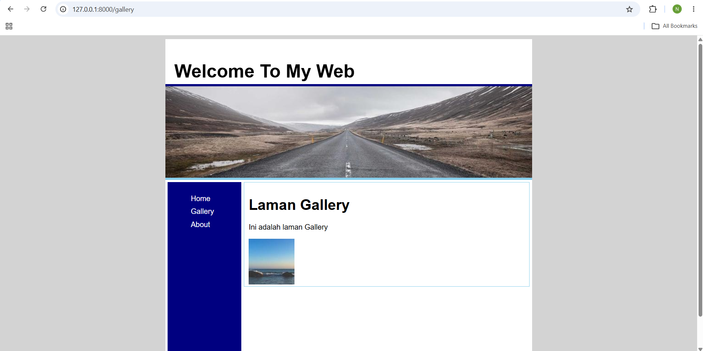

---

## 4. Membuat CRUD Tampil Data

Data pegawai disimpan di tabel `employes` pada database `company`, dan
diambil memakai Eloquent (`Employe::all()`).

| File | Fungsi |
|------|--------|
| `database/company.sql` | SQL pembuat database dan tabel `employes` beserta data awal |
| `.env` | Pengaturan koneksi database |
| `app/Models/Employe.php` | Model tabel `employes` |
| `app/Http/Controllers/EmployeController.php` | Fungsi `index` |
| `resources/views/tampil_data.blade.php` | Tabel data pegawai |

| Method | URL | Fungsi |
|--------|-----|--------|
| GET | `/employe` | `index` |

**Hasil**

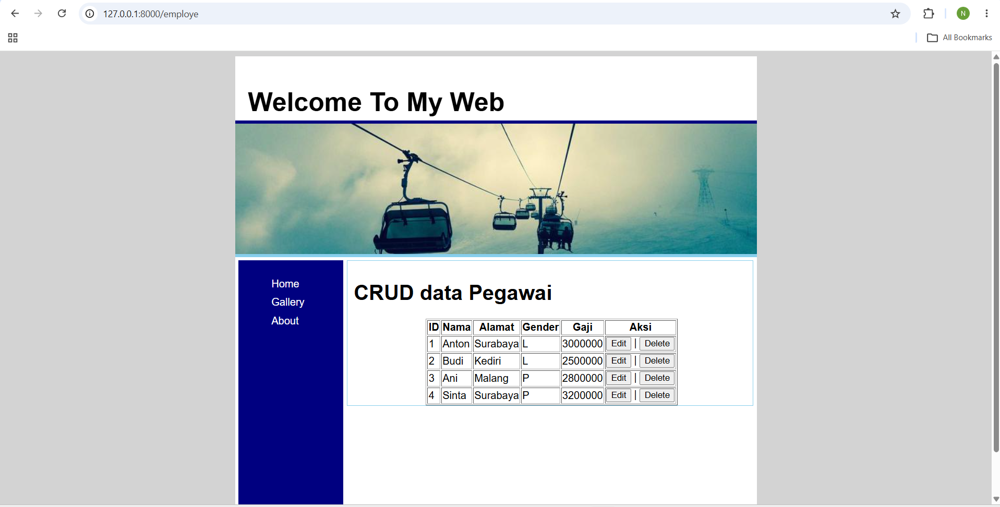

---

## 5. Membuat CRUD Simpan Data

| File | Fungsi |
|------|--------|
| `EmployeController.php` | Fungsi `create` (form) dan `store` (simpan) |
| `resources/views/tambah_data.blade.php` | Form tambah data |

| Method | URL | Fungsi |
|--------|-----|--------|
| GET | `/employe/create` | `create` |
| POST | `/employe/store` | `store` |

> Form tambah data dibuka lewat URL `/employe/create`.

**Hasil**

Form tambah data:
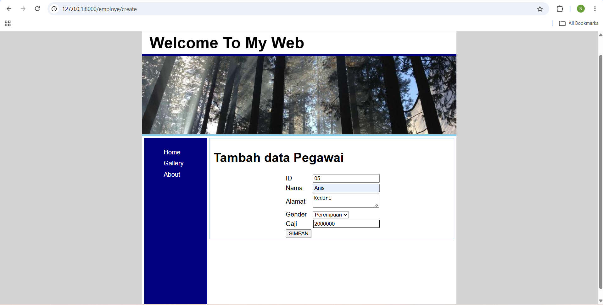

Setelah data ditambahkan:
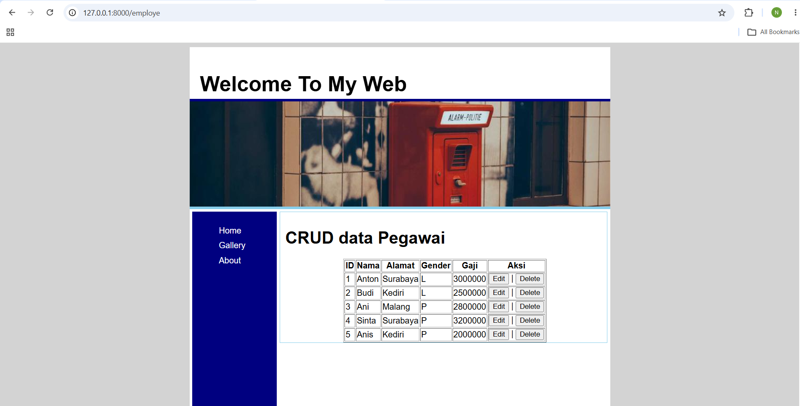

---

## 6. Membuat CRUD Ubah Data

| File | Fungsi |
|------|--------|
| `EmployeController.php` | Fungsi `show` (form edit) dan `update` (ubah) |
| `resources/views/edit_data.blade.php` | Form edit data |

| Method | URL | Fungsi |
|--------|-----|--------|
| GET | `/employe/edit/{employe}` | `show` |
| PUT | `/employe/{employe}` | `update` |

Form edit memakai `@method('put')`, dan tombol **Edit** pada tabel
mengarah ke `/employe/edit/{id}`.

**Hasil**

Form edit data:
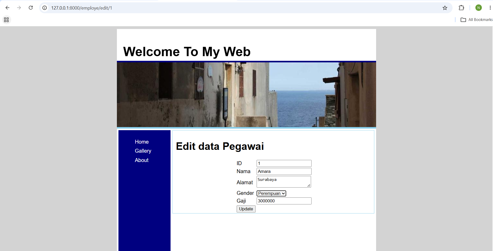

Setelah data diubah:


---

## 7. Membuat CRUD Hapus Data

| File | Fungsi |
|------|--------|
| `EmployeController.php` | Fungsi `destroy` |
| `resources/views/tampil_data.blade.php` | Tombol **Delete** (form dengan `@method('delete')`) |

| Method | URL | Fungsi |
|--------|-----|--------|
| DELETE | `/employe/{employe}` | `destroy` |

**Hasil**

Setelah data dihapus:
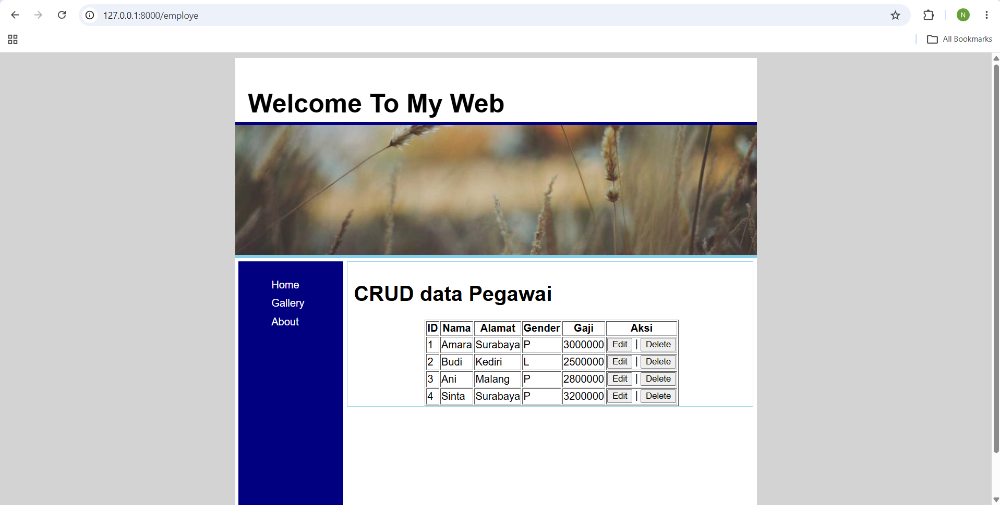

---

## 8. Tentang Migration, Seeder dan Factory

Struktur tabel dibuat lewat kode (migration), dan datanya diisi otomatis
(seeder dengan Faker).

| File | Fungsi |
|------|--------|
| `database/migrations/0001_01_01_000000_create_users_table.php` | Tabel `users` (`nama`, `email`, `password`, `foto`, `role`) |
| `database/migrations/2026_11_19_090001_create_employes_table.php` | Tabel `employes` |
| `database/seeders/UserSeeder.php` | 1 data user (password dienkripsi dengan `Hash::make`) |
| `database/seeders/EmployeSeeder.php` | 10 data pegawai acak (Faker `id_ID`) |
| `database/seeders/DatabaseSeeder.php` | Memanggil kedua seeder |

Perintah yang dipakai:

```
php artisan migrate
php artisan migrate:rollback
php artisan migrate:fresh
php artisan make:migration create_employes_table
php artisan make:seeder UserSeeder
php artisan db:seed --class=UserSeeder
php artisan make:seeder EmployeSeeder
php artisan db:seed
```

**Hasil**

Hasil `php artisan migrate`:
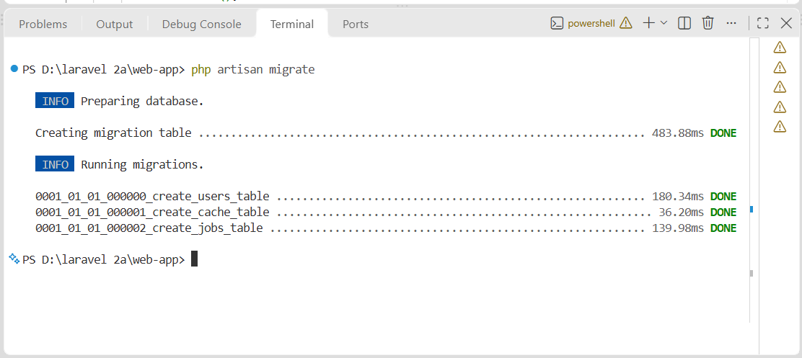

Struktur tabel `users`:


Daftar tabel di database `company`:
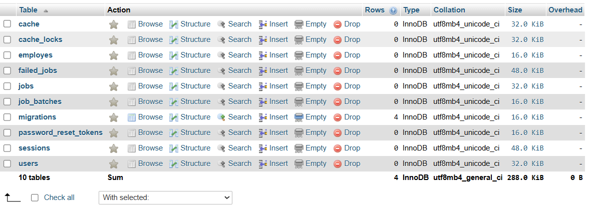

Struktur tabel `employes`:


Isi tabel `users` (hasil seeder):
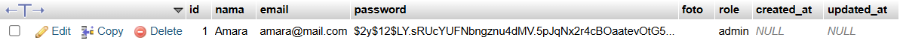

Isi tabel `employes` (10 data Faker):
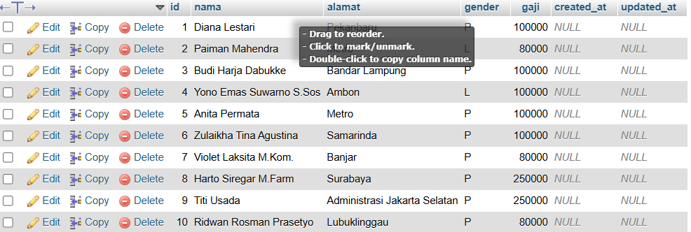

Halaman `/employe` dengan data Faker:
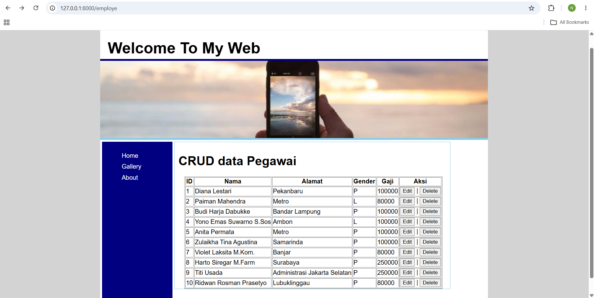

---

## 9. Membuat Autentifikasi

Login memakai session. Halaman dashboard, gallery, dan CRUD hanya bisa dibuka
setelah login, dijaga oleh middleware `islogin`. Orang yang belum login
diarahkan ke halaman login.

| File | Fungsi |
|------|--------|
| `resources/views/login.blade.php` | Form login |
| `app/Http/Controllers/AuthController.php` | Fungsi `cek` (login) dan `logout` |
| `app/Http/Middleware/IsLogin.php` | Middleware pengecek session login |
| `bootstrap/app.php` | Mendaftarkan alias middleware `islogin` |
| `resources/views/template/sidebar.blade.php` | Menu CRUD dan Logout |
| `routes/web.php` | `Route::group(['middleware' => 'islogin'], ...)` |

| Method | URL | Keterangan |
|--------|-----|------------|
| GET | `/` | Form login |
| POST | `/login` | Proses login (`AuthController@cek`) |
| GET | `/dashboard`, `/gallery`, `/employe...` | Harus login |
| GET | `/logout` | Logout (harus login) |

Di Laravel 13 tidak ada `Kernel.php` seperti di modul (Laravel 8), jadi alias
middleware didaftarkan di `bootstrap/app.php`.

**Hasil**

Halaman login:
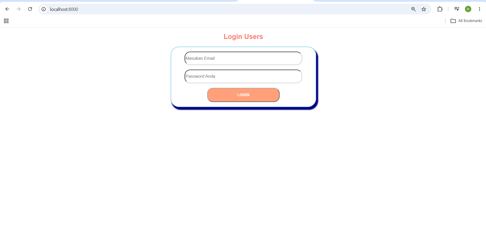

Akses `/dashboard` tanpa login, diarahkan ke login:
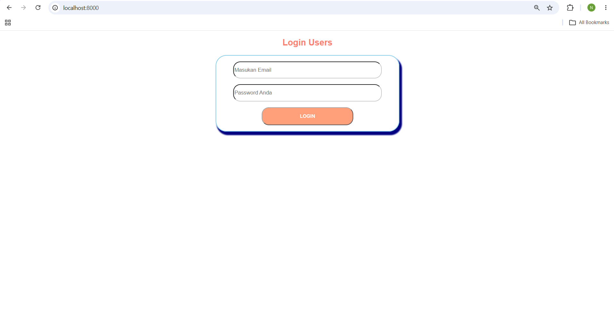

Dashboard setelah login (menu CRUD dan Logout muncul):
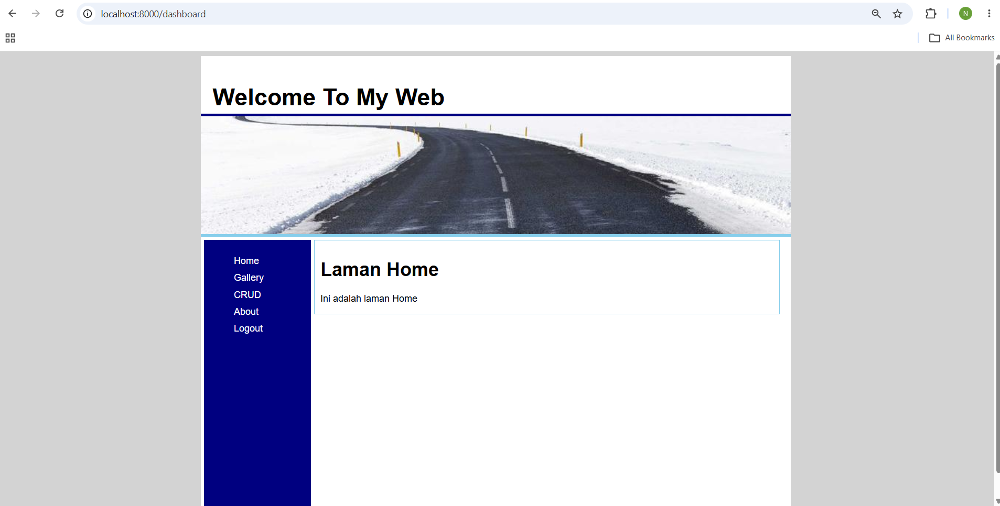

Halaman CRUD setelah login:
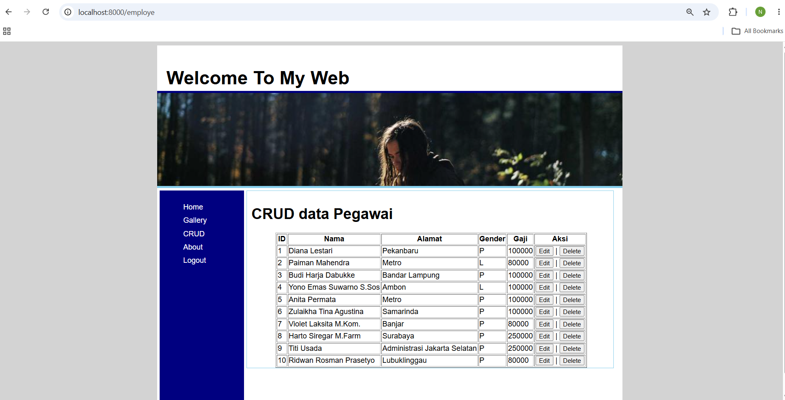

## Referensi

- Modul Praktikum Framework Laravel, Rudy Eko Prasetya, S.Kom
- Dokumentasi Laravel: https://laravel.com/docs
- Dokumentasi Bootstrap: https://getbootstrap.com/docs/5.3

---


<p align="center"><a href="https://laravel.com" target="_blank"></a></p>

<p align="center">
<a href="https://github.com/laravel/framework/actions"></a>
<a href="https://packagist.org/packages/laravel/framework"></a>
<a href="https://packagist.org/packages/laravel/framework"></a>
<a href="https://packagist.org/packages/laravel/framework"></a>
</p>

## About Laravel

Laravel is a web application framework with expressive, elegant syntax. We believe development must be an enjoyable and creative experience to be truly fulfilling. Laravel takes the pain out of development by easing common tasks used in many web projects, such as:

- [Simple, fast routing engine](https://laravel.com/docs/routing).
- [Powerful dependency injection container](https://laravel.com/docs/container).
- Multiple back-ends for [session](https://laravel.com/docs/session) and [cache](https://laravel.com/docs/cache) storage.
- Expressive, intuitive [database ORM](https://laravel.com/docs/eloquent).
- Database agnostic [schema migrations](https://laravel.com/docs/migrations).
- [Robust background job processing](https://laravel.com/docs/queues).
- [Real-time event broadcasting](https://laravel.com/docs/broadcasting).

Laravel is accessible, powerful, and provides tools required for large, robust applications.

## Learning Laravel

Laravel has the most extensive and thorough [documentation](https://laravel.com/docs) and video tutorial library of all modern web application frameworks, making it a breeze to get started with the framework.

In addition, [Laracasts](https://laracasts.com) contains thousands of video tutorials on a range of topics including Laravel, modern PHP, unit testing, and JavaScript. Boost your skills by digging into our comprehensive video library.

You can also watch bite-sized lessons with real-world projects on [Laravel Learn](https://laravel.com/learn), where you will be guided through building a Laravel application from scratch while learning PHP fundamentals.

## Agentic Development

Laravel's predictable structure and conventions make it ideal for AI coding agents like Claude Code, Cursor, and GitHub Copilot. Install [Laravel Boost](https://laravel.com/docs/ai) to supercharge your AI workflow:

```bash
composer require laravel/boost --dev

php artisan boost:install
```

Boost provides your agent 15+ tools and skills that help agents build Laravel applications while following best practices.

## Contributing

Thank you for considering contributing to the Laravel framework! The contribution guide can be found in the [Laravel documentation](https://laravel.com/docs/contributions).

## Code of Conduct

In order to ensure that the Laravel community is welcoming to all, please review and abide by the [Code of Conduct](https://laravel.com/docs/contributions#code-of-conduct).

## Security Vulnerabilities

If you discover a security vulnerability within Laravel, please send an e-mail to Taylor Otwell via [taylor@laravel.com](mailto:taylor@laravel.com). All security vulnerabilities will be promptly addressed.

## License

The Laravel framework is open-sourced software licensed under the [MIT license](https://opensource.org/licenses/MIT).
