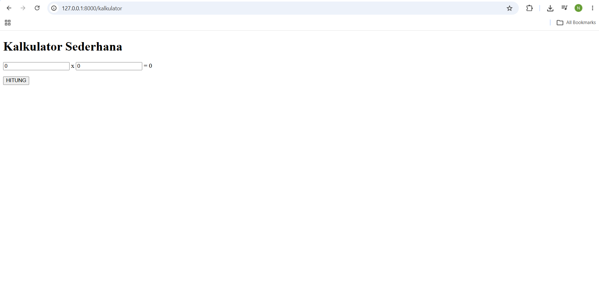
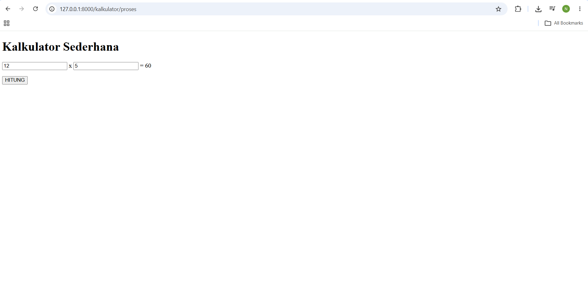
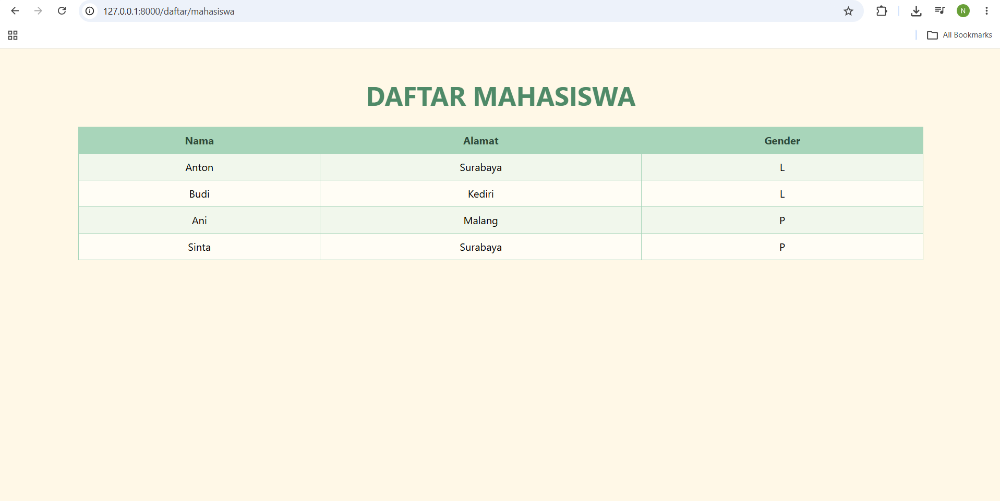
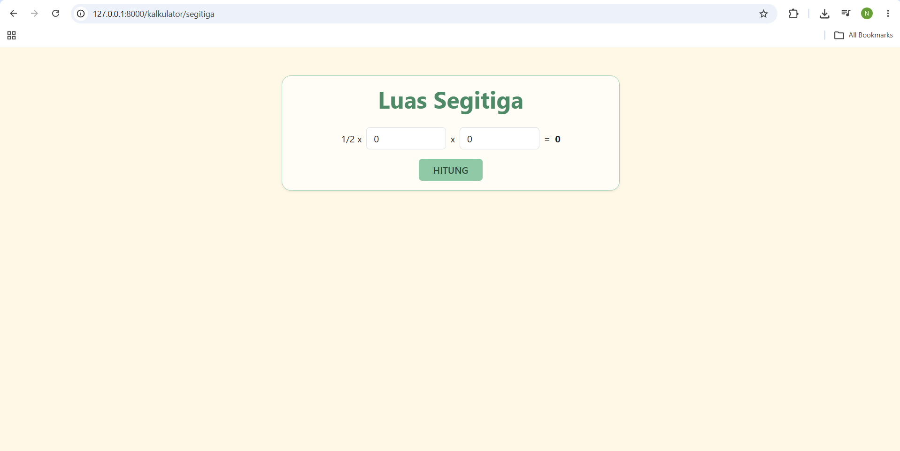
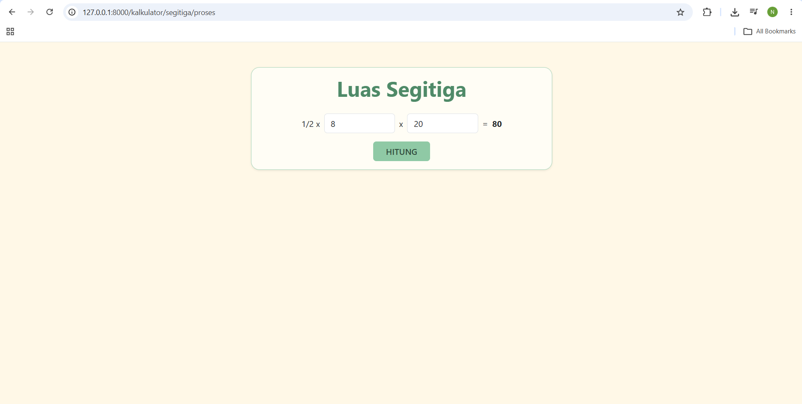

# Tugas Praktikum Framework Laravel

Tugas praktikum Pemrograman Web menggunakan framework Laravel. Materi yang
dipraktikkan meliputi Route, Controller, dan Parsing Data ke View.

- **Nama:** AMARA DWI NATARIN
- **NPM:** 2513020050
- **Repository:** https://github.com/amaranatarin-arch/laravel-2a.git

## Deskripsi

Aplikasi sederhana yang berisi tiga halaman:

1. **Kalkulator Perkalian** (`/kalkulator`): praktik dari materi. Form untuk
   mengalikan dua angka.
2. **Daftar Mahasiswa** (`/daftar/mahasiswa`): latihan soal. Menampilkan data
   mahasiswa (Nama, Alamat, Gender) dalam bentuk tabel.
3. **Kalkulator Luas Segitiga** (`/kalkulator/segitiga`): latihan soal. Form
   untuk menghitung luas segitiga (`1/2 x alas x tinggi`).

Data dikirim dari Controller ke View menggunakan array `$data`, lalu
ditampilkan dengan Blade (`{{ }}` dan `@foreach`).

## Teknologi

- PHP 8.3 atau lebih baru
- Laravel 13
- Composer
- Bootstrap 5 (CDN) dan CSS buatan sendiri (tema soft green dan cream)

## Daftar Halaman (Route)

| Method | URL | Controller | Fungsi | Keterangan |
|--------|-----|------------|--------|------------|
| GET | `/kalkulator` | `KalkulatorController` | `home` | Form kalkulator perkalian (materi) |
| POST | `/kalkulator/proses` | `KalkulatorController` | `proses` | Proses perkalian (materi) |
| GET | `/daftar/mahasiswa` | `MahasiswaController` | `index` | Tabel daftar mahasiswa |
| GET | `/kalkulator/segitiga` | `KalkulatorController` | `segitiga` | Form luas segitiga |
| POST | `/kalkulator/segitiga/proses` | `KalkulatorController` | `hitungSegitiga` | Proses hitung luas |

## Struktur File Penting

```
web-app
 |- app/Http/Controllers
 |    |- MahasiswaController.php     (baru)
 |    |- KalkulatorController.php    (ditambah segitiga + hitungSegitiga)
 |- public/css
 |    |- style.css                   (tema soft green + cream)
 |- resources/views
 |    |- kalkulator.blade.php        (materi)
 |    |- mahasiswa.blade.php         (latihan)
 |    |- segitiga.blade.php          (latihan)
 |- routes
      |- web.php                     (ditambah 3 route)
```

## Cara Menjalankan

1. Masuk ke folder project:

   ```
   cd web-app
   ```

2. Install dependency (jika folder `vendor` belum ada):

   ```
   composer install
   ```

3. Siapkan file environment (jika belum ada `.env`):

   ```
   copy .env.example .env
   php artisan key:generate
   ```

4. Jalankan server:

   ```
   php artisan serve
   ```

5. Buka di browser:

   - http://localhost:8000/kalkulator
   - http://localhost:8000/daftar/mahasiswa
   - http://localhost:8000/kalkulator/segitiga

> Koneksi internet diperlukan karena Bootstrap dimuat lewat CDN.

## Contoh Pengujian

- `/kalkulator`: isi `4` dan `5`, klik **HITUNG**, hasilnya **20**.
- `/daftar/mahasiswa` menampilkan 4 baris: Anton, Budi, Ani, Sinta.
- `/kalkulator/segitiga`: isi alas `10` dan tinggi `6`, klik **HITUNG**, hasilnya **30**.

## Screenshot

### 1. Kalkulator Perkalian, sebelum dihitung (`/kalkulator`)


### 2. Kalkulator Perkalian, setelah dihitung


### 3. Daftar Mahasiswa (`/daftar/mahasiswa`)


### 4. Kalkulator Segitiga, sebelum dihitung (`/kalkulator/segitiga`)


### 5. Kalkulator Segitiga, setelah dihitung


## Referensi

- Modul Praktikum Framework Laravel, Rudy Eko Prasetya, S.Kom
- Dokumentasi Laravel: https://laravel.com/docs
- Dokumentasi Bootstrap: https://getbootstrap.com/docs/5.3

---


<p align="center"><a href="https://laravel.com" target="_blank"></a></p>

<p align="center">
<a href="https://github.com/laravel/framework/actions"></a>
<a href="https://packagist.org/packages/laravel/framework"></a>
<a href="https://packagist.org/packages/laravel/framework"></a>
<a href="https://packagist.org/packages/laravel/framework"></a>
</p>

## About Laravel

Laravel is a web application framework with expressive, elegant syntax. We believe development must be an enjoyable and creative experience to be truly fulfilling. Laravel takes the pain out of development by easing common tasks used in many web projects, such as:

- [Simple, fast routing engine](https://laravel.com/docs/routing).
- [Powerful dependency injection container](https://laravel.com/docs/container).
- Multiple back-ends for [session](https://laravel.com/docs/session) and [cache](https://laravel.com/docs/cache) storage.
- Expressive, intuitive [database ORM](https://laravel.com/docs/eloquent).
- Database agnostic [schema migrations](https://laravel.com/docs/migrations).
- [Robust background job processing](https://laravel.com/docs/queues).
- [Real-time event broadcasting](https://laravel.com/docs/broadcasting).

Laravel is accessible, powerful, and provides tools required for large, robust applications.

## Learning Laravel

Laravel has the most extensive and thorough [documentation](https://laravel.com/docs) and video tutorial library of all modern web application frameworks, making it a breeze to get started with the framework.

In addition, [Laracasts](https://laracasts.com) contains thousands of video tutorials on a range of topics including Laravel, modern PHP, unit testing, and JavaScript. Boost your skills by digging into our comprehensive video library.

You can also watch bite-sized lessons with real-world projects on [Laravel Learn](https://laravel.com/learn), where you will be guided through building a Laravel application from scratch while learning PHP fundamentals.

## Agentic Development

Laravel's predictable structure and conventions make it ideal for AI coding agents like Claude Code, Cursor, and GitHub Copilot. Install [Laravel Boost](https://laravel.com/docs/ai) to supercharge your AI workflow:

```bash
composer require laravel/boost --dev

php artisan boost:install
```

Boost provides your agent 15+ tools and skills that help agents build Laravel applications while following best practices.

## Contributing

Thank you for considering contributing to the Laravel framework! The contribution guide can be found in the [Laravel documentation](https://laravel.com/docs/contributions).

## Code of Conduct

In order to ensure that the Laravel community is welcoming to all, please review and abide by the [Code of Conduct](https://laravel.com/docs/contributions#code-of-conduct).

## Security Vulnerabilities

If you discover a security vulnerability within Laravel, please send an e-mail to Taylor Otwell via [taylor@laravel.com](mailto:taylor@laravel.com). All security vulnerabilities will be promptly addressed.

## License

The Laravel framework is open-sourced software licensed under the [MIT license](https://opensource.org/licenses/MIT).
